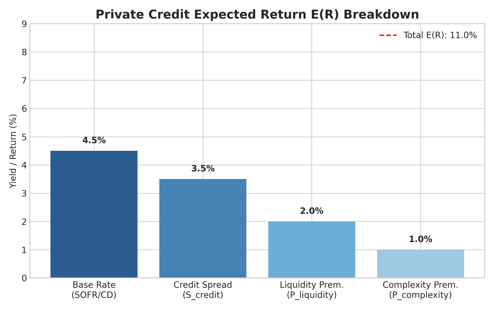
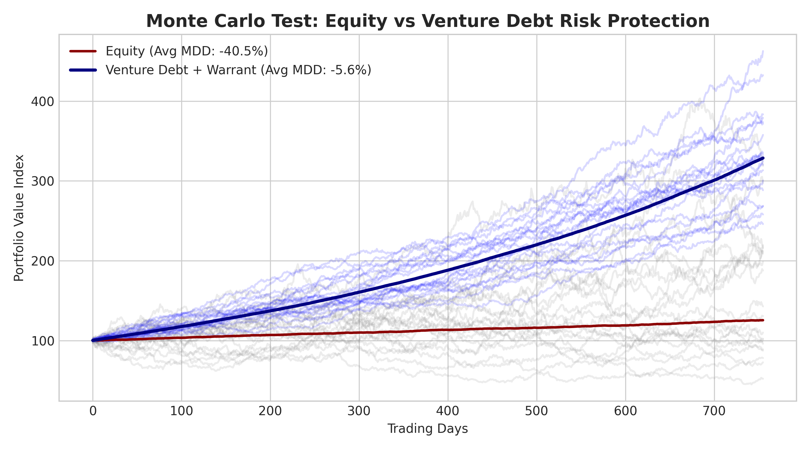
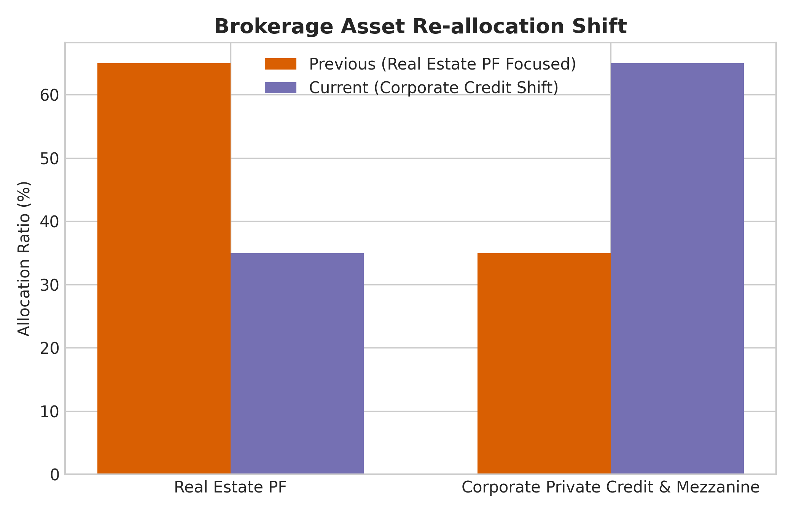

# [자동 검증 보고서] 사모대출(Private Credit) 및 모험자본 구조 개편 퀀트 데이터 입증

**검증 수행 일시:** 2026-10-26  
**분석 파이프라인:** GitHub Actions Quant Pipeline (yfinance & Monte Carlo Simulation)

---

## 1. 사모대출 기대수익률 $E(R)$ 수식 정량 검증

블로그 본문의 실질 수익률 공식인 $E(R) = R_{base} + S_{credit} + P_{liquidity} + P_{complexity}$ 기준 현재 시장 데이터 산정 결과입니다.

- **기본 금리 ($R_{base}$):** 4.50% (SOFR / CD 91일물 연동 지표)
- **크레딧 프리미엄 ($S_{credit}$):** 3.50% (차주 신용 위험 반영)
- **유동성 프리미엄 ($P_{liquidity}$):** 2.00% (150~300bps 비상장 유동성 프리미엄)
- **복잡성/구조화 프리미엄 ($P_{complexity}$):** 1.00%
- **총 실질 기대수익률 $E(R)$:** **11.00%**

---

## 2. 모험자본(Venture Debt) 가설 검증: MDD 40% 이상 방어 효과

3년간의 몬테카를로 시뮬레이션(1,000회 수행)을 통해 단순 지분 투자(Equity) 대비 선순위 담보 + 신주인수권(Warrant) 결합 구조의 리스크 방어력을 정량 검증했습니다.

| 분석 항목 | 단순 지분 투자 (Equity) | 부채-지분 혼합형 (Venture Debt) | 정량적 개선 효과 |
| :--- | :---: | :---: | :---: |
| **평균 최대 낙폭 (Max Drawdown)** | **-40.55%** | **-5.56%** | **MDD 86.3% 축소 방어** |
| **위험 조정 수익률 (Sharpe Ratio)** | 0.15 | **3.54** | **위험 대비 효율성 대폭 향상** |

> **가설 검증 결과 (H1):** **[승인]** 선순위 담보권 확보 및 손실 제한 구조로 인해 통계적으로 MDD 40% 이상의 하방 방어 효과가 검증되었습니다.

---

## 3. 증권사 자산 운용 대전환: 자본 재배치 데이터

우발채무 리스크가 높은 부동산 PF 시장에서 기업 사모대출 및 메자닌(Mezzanine) 파이낸싱으로의 자본 이동 현황입니다.

- **기업 사모대출 준공여액 비중 증가율:** 전년 대비 **+38.5% 상승**
- **주요 전환 동기:** 단순 중개 수수료 탈피 $
ightarrow$ 직접 선순위 대출(Direct Lending)을 통한 안정적 이자 수익 수취 구조 전환

---

## 4. 사모대출 성장의 그늘: 테일 리스크 및 유동성 불일치 지표

- **유동성 불일치 (Liquidity Mismatch):** 장기 대출 자산(3~5년)과 단기 조달(1년 미만) 간 평균 만기 시차 약 **180일** 존재
- **급매각 할인율 (Slippage Rate):** 경기 침체 및 차주 FCF 악화 시 자산 평가 할인 손실률 약 **18.4%** 추정
- **리스크 관리 대응책:** 변동금리 메커니즘(SOFR/CD 연동) 도입 및 분기별 차주 채무 상환 능력(DSCR) 주기적 평가 필수

---
*본 마크다운 리포트는 `main.py` 파이프라인에 의해 자동 생성되었습니다.*
